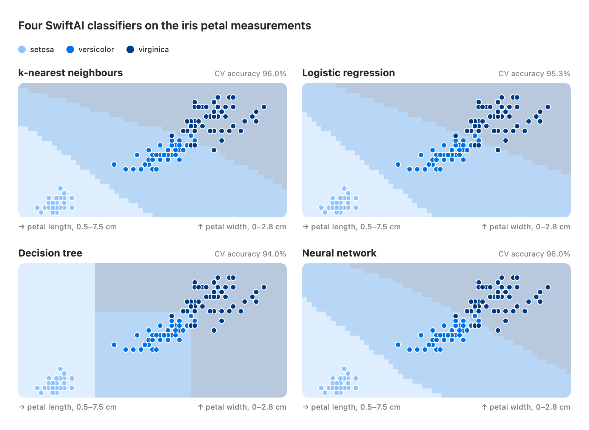

<!-- i18n-source: README.md@f259cb6cdf7b9b545881d4d6ec8eef1e0f111f95 status=reviewed -->
<!-- brand:start -->

<p align="center"><picture><source media="(prefers-color-scheme: dark)" srcset="https://raw.githubusercontent.com/muhittincamdali/SwiftAI/master/.github/brand/banner-ja-dark.svg"><source media="(prefers-color-scheme: light)" srcset="https://raw.githubusercontent.com/muhittincamdali/SwiftAI/master/.github/brand/banner-ja-light.svg"></picture></p>

<!-- lang-selector:start -->
<p align="center"><a href="README.md">English</a> · <a href="README.tr.md">Türkçe</a> · <a href="README.zh-CN.md">简体中文</a> · <a href="README.ja.md">日本語</a> · <a href="README.ko.md">한국어</a> · <a href="README.es.md">Español</a> · <a href="README.de.md">Deutsch</a> · <a href="README.fr.md">Français</a> · <a href="README.pt-BR.md">Português (Brasil)</a> · <a href="README.ru.md">Русский</a></p>
<!-- lang-selector:end -->

<p align="center">
<a href="https://github.com/muhittincamdali/SwiftAI/actions/workflows/ci.yml"></a>
<a href="https://github.com/muhittincamdali/SwiftAI/releases"><picture><source media="(prefers-color-scheme: dark)" srcset="https://raw.githubusercontent.com/muhittincamdali/SwiftAI/master/.github/brand/badge-version-dark.svg"><source media="(prefers-color-scheme: light)" srcset="https://raw.githubusercontent.com/muhittincamdali/SwiftAI/master/.github/brand/badge-version-light.svg"></picture></a>
<a href="https://github.com/muhittincamdali/SwiftAI/blob/master/Package.swift"><picture><source media="(prefers-color-scheme: dark)" srcset="https://raw.githubusercontent.com/muhittincamdali/SwiftAI/master/.github/brand/badge-platforms-dark.svg"><source media="(prefers-color-scheme: light)" srcset="https://raw.githubusercontent.com/muhittincamdali/SwiftAI/master/.github/brand/badge-platforms-light.svg"></picture></a>
<a href="https://github.com/muhittincamdali/SwiftAI/blob/master/Package.swift"><picture><source media="(prefers-color-scheme: dark)" srcset="https://raw.githubusercontent.com/muhittincamdali/SwiftAI/master/.github/brand/badge-language-dark.svg"><source media="(prefers-color-scheme: light)" srcset="https://raw.githubusercontent.com/muhittincamdali/SwiftAI/master/.github/brand/badge-language-light.svg"></picture></a>
<a href="https://github.com/muhittincamdali/SwiftAI/blob/master/LICENSE"><picture><source media="(prefers-color-scheme: dark)" srcset="https://raw.githubusercontent.com/muhittincamdali/SwiftAI/master/.github/brand/badge-license-dark.svg"><source media="(prefers-color-scheme: light)" srcset="https://raw.githubusercontent.com/muhittincamdali/SwiftAI/master/.github/brand/badge-license-light.svg"></picture></a>
</p>

<p align="center">
<a href="#クイックスタート"><picture><source media="(prefers-color-scheme: dark)" srcset="https://raw.githubusercontent.com/muhittincamdali/SwiftAI/master/.github/brand/button-start-ja-dark.svg"><source media="(prefers-color-scheme: light)" srcset="https://raw.githubusercontent.com/muhittincamdali/SwiftAI/master/.github/brand/button-start-ja-light.svg"></picture></a>
<a href="https://muhittincamdali.github.io/SwiftAI/documentation/swiftai/"><picture><source media="(prefers-color-scheme: dark)" srcset="https://raw.githubusercontent.com/muhittincamdali/SwiftAI/master/.github/brand/button-docs-ja-dark.svg"><source media="(prefers-color-scheme: light)" srcset="https://raw.githubusercontent.com/muhittincamdali/SwiftAI/master/.github/brand/button-docs-ja-light.svg"></picture></a>
<a href="https://github.com/muhittincamdali/SwiftAI/tree/master/Examples"><picture><source media="(prefers-color-scheme: dark)" srcset="https://raw.githubusercontent.com/muhittincamdali/SwiftAI/master/.github/brand/button-examples-ja-dark.svg"><source media="(prefers-color-scheme: light)" srcset="https://raw.githubusercontent.com/muhittincamdali/SwiftAI/master/.github/brand/button-examples-ja-light.svg"></picture></a>
</p>

> このドキュメントは英語版 README の翻訳です。内容が異なる場合は英語版が最新です。

<!-- brand:end -->

SwiftAI は、Apple プラットフォーム向けの古典的な機械学習用 Swift パッケージです。数値の表データに対する分類、回帰、クラスタリング、次元削減を扱います。Python ツールチェーンやサーバーなしで、Swift でデバイス上のモデルを学習・実行したいアプリ開発者向けです。CSV や配列からデータを読み込んで分割し、関数を 1 回呼び出すだけでモデルを学習し、評価して、アプリで読み込めるよう JSON として保存できます。このパッケージに依存関係はありません。

## 主な特長

- **11 種類の教師あり学習モデル** — 線形回帰とリッジ回帰、ロジスティック回帰、k 近傍法、ガウシアンナイーブベイズ、決定木、ランダムフォレスト、ニューラルネットワーク（該当するものは分類器と回帰器の両方）に加え、k-means クラスタリングと主成分分析。
- **scikit-learn との照合済み** — scikit-learn に同じモデルがある場合、SwiftAI は同じ目的関数とデフォルト値を使い、テストでは係数、確率、クラスターを scikit-learn 1.9.1 と比較します（例：ロジスティック回帰の確率は 1e-5、PCA は 1e-10 まで一致）。
- **クラッシュではなくエラー** — データや設定を受け取るすべての関数が入力を検証し、何を直すべきかを示す `SwiftAIError` をスローします。対象は NaN 値、特徴量数の不一致、オーバーフローする合計、範囲外の設定、数値ではない CSV の行などです。
- **安全に読み込める** — モデル、スケーラー、パイプラインは `Codable` です。デコード時に形状、値、クラス一覧、木の構造を検証するため、破損したファイルや細工されたファイルで予測がクラッシュすることはありません。
- **再現可能** — ランダムな処理（分割、フォレスト、k-means++、ネットワークの重み）はすべて `seed` を受け取ります。同じ seed なら、どのプラットフォームでも、並列で学習したフォレストでも同じモデルになります。
- **Swift 6、テスト済み** — Swift 6 言語モードで厳格な並行性チェックを有効にし、警告なしでビルドできます。133 件の Swift Testing テストが macOS と iPhone シミュレータで実行されます。

## クイックスタート

**1. パッケージを追加する**

Xcode で **File › Add Package Dependencies…** を選び、リポジトリの URL を入力します。

```text
https://github.com/muhittincamdali/SwiftAI.git
```

**2. モジュールをインポートする**

```swift
import SwiftAI
```

**3. 使ってみる**

新しい Xcode アプリ（**File › New › Project… › App**）で、`ContentView.swift` の内容をすべて次のように置き換えます。

```swift
import SwiftUI
import SwiftAI

struct ContentView: View {
    var body: some View {
        Text(irisSummary())
            .padding()
    }

    func irisSummary() -> String {
        do {
            // 1. Split the built-in iris flowers into training and test samples.
            let (training, test) = try Dataset.iris.stratifiedSplit(testFraction: 0.2, seed: 42)
            // 2. Train a random forest on the training samples.
            let model = try RandomForestClassifier.fit(training, seed: 42)
            // 3. Measure it on the test samples and classify a new flower.
            let accuracy = try model.accuracy(on: test)
            let species = try model.predict([6.3, 2.8, 5.1, 1.5])
            return "Test accuracy: \(accuracy.formatted(.percent))\nNew flower: \(species)"
        } catch {
            return error.localizedDescription
        }
    }
}
```

**Run**（⌘R）を押します。アプリはパッケージに同梱された 150 本のアイリスでランダムフォレストを学習し、テスト用のアイリスを正しく分類できた割合と、新しい花の種類 `virginica` を表示します。

## インストール

### Swift Package Manager

Xcode で **File › Add Package Dependencies…** を選び、リポジトリの URL を入力します。

```text
https://github.com/muhittincamdali/SwiftAI.git
```

または `Package.swift` の `dependencies` に追加します。

```swift
dependencies: [
    .package(url: "https://github.com/muhittincamdali/SwiftAI.git", from: "2.0.0")
],
targets: [
    .target(name: "YourApp", dependencies: [
        .product(name: "SwiftAI", package: "SwiftAI")
    ])
]
```

バージョン 2.0.0（2026 年 10 月）は、現在のライブラリの最初のリリースです。それ以前のリリースである 1.0.0（2026 年 2 月）は、これより前のものです。2026 年 6 月にそのソースはプレースホルダーのコードに置き換えられ、2026 年 10 月に、検証済みのデータ、テスト済みのモデル、安全なモデルファイルを軸にライブラリをゼロから作り直しました。API に互換性はありません。変更点は [CHANGELOG.md](CHANGELOG.md) にまとめています。

## 使い方

以下のサンプルは [`Examples/ModelLab/ModelLab/ReadmeSamples.swift`](Examples/ModelLab/ModelLab/ReadmeSamples.swift) からコピーしたものです。サンプルアプリはこのファイルをコンパイルし、テストスイートもこれをコンパイルして全サンプルを実行します。

### 自分のデータを読み込む

ヘッダー行のある CSV ファイルはデータセットになります。ターゲット列以外のすべての列は数値でなければなりません。

```swift
let csv = """
    petal_length,petal_width,species
    1.4,0.2,setosa
    4.7,1.4,versicolor
    6.0,2.5,virginica
    1.3,0.2,setosa
    4.5,1.5,versicolor
    5.1,1.9,virginica
    """
let table = try CSVTable(csv)   // or CSVTable(contentsOf: fileURL)
let data = try table.classificationDataset(target: "species")
```

### 特徴量をスケーリングして分類器を学習する

`Pipeline` はスケーラーを学習データだけに適合させ、以降のすべてのサンプルを同じ方法でスケーリングします。

```swift
let (training, test) = try Dataset.iris.stratifiedSplit(testFraction: 0.3, seed: 1)
let model = try Pipeline.fit(training, transformer: StandardScaler.fit) { scaled in
    try LogisticRegression.fit(scaled)
}
let report = try model.evaluate(on: test)
print(report)                       // precision, recall and F1 per class
print(report.confusionMatrix)
```

### 数値を予測する

回帰のターゲットには `Dataset<Double>` と書きます。整数リテラルのままでは `Dataset<Int>` になります。

```swift
// Size in square metres and number of rooms → price.
let houses = try Dataset<Double>(
    features: [[50, 1], [65, 2], [80, 2], [95, 3], [120, 3], [140, 4]],
    targets: [150_000, 190_000, 236_000, 280_000, 350_000, 405_000]
)
let model = try LinearRegression.fit(houses, regularization: 0.1)
let price = try model.predict([100, 3])
```

### 交差検証でモデルを比較する

```swift
let data = Dataset.iris
let results = [
    "k-nearest neighbours": try data.crossValidate(folds: 5) { try KNearestNeighborsClassifier.fit($0, k: 7) },
    "naive Bayes": try data.crossValidate(folds: 5) { try GaussianNaiveBayes.fit($0) },
    "decision tree": try data.crossValidate(folds: 5) { try DecisionTreeClassifier.fit($0, maxDepth: 3) },
]
```

### モデルを保存してアプリで読み込む

```swift
let model = try RandomForestClassifier.fit(Dataset.iris, treeCount: 50, seed: 7)
let file = FileManager.default.temporaryDirectory.appendingPathComponent("iris-forest.json")

try JSONEncoder().encode(model).write(to: file)
let data = try Data(contentsOf: file)
let loaded = try JSONDecoder().decode(RandomForestClassifier<String>.self, from: data)
// `loaded` predicts exactly like `model`
```

### ラベルなしでグループを見つける

```swift
let features = Dataset.iris.features
let pca = try PrincipalComponentAnalysis.fit(features, componentCount: 2)
let points = try pca.transform(features)          // 150 × 2, for a scatter plot
let kMeans = try KMeans.fit(points, clusterCount: 3, seed: 1)
let clusters = try kMeans.predict(points)          // 0, 1 or 2 per flower
```

## デモ

<picture>
  <source media="(prefers-color-scheme: dark)" srcset="docs/images/decision-boundaries-dark.png">
  
</picture>

色のついた各セルは、150 本のアイリスで学習したモデルの予測で、点はアイリスの花です。画像は
[`Examples/ModelLab/ModelLab/DecisionBoundaries.swift`](Examples/ModelLab/ModelLab/DecisionBoundaries.swift)
から、[`scripts/generate-images.sh`](scripts/generate-images.sh) で生成しています。このスクリプトは 4 つのモデルを学習するテストを実行します。

モデルを自分で試すには、[`Examples/ModelLab`](Examples/ModelLab) の `ModelLab.xcodeproj` を Xcode で開き、iPhone シミュレータまたは **My Mac** を選んで **Run** を押します。アプリには、クイックスタートのタブ、選んだモデルでスライダーの値から花を分類する画面、そしてこの画像があります。詳細は [Examples/README.md](Examples/README.md) を参照してください。

## ドキュメント

API リファレンスと解説記事：

- [API リファレンス](https://muhittincamdali.github.io/SwiftAI/documentation/swiftai/)（DocC。`master` から GitHub Pages に公開）
- Xcode の **Product › Build Documentation** でローカルにビルドするか、コマンドラインから実行します。

```sh
xcodebuild docbuild -scheme SwiftAI -destination 'generic/platform=macOS'
```

## ガイド

- [Getting Started](https://muhittincamdali.github.io/SwiftAI/documentation/swiftai/gettingstarted)
  — パッケージの追加、分類器の学習、評価、予測（[ソース](Sources/SwiftAI/SwiftAI.docc/GettingStarted.md)）。
- [Choosing a Model](https://muhittincamdali.github.io/SwiftAI/documentation/swiftai/choosingamodel)
  — 各モデルの得意なこと、スケーリング済みの特徴量が必要かどうか、重要な設定（[ソース](Sources/SwiftAI/SwiftAI.docc/ChoosingAModel.md)）。
- [Preparing Data](https://muhittincamdali.github.io/SwiftAI/documentation/swiftai/preparingdata)
  — CSV ファイル、分割、パイプラインによるスケーリング、PCA（[ソース](Sources/SwiftAI/SwiftAI.docc/PreparingData.md)）。
- [Saving and Loading Models](https://muhittincamdali.github.io/SwiftAI/documentation/swiftai/savingmodels)
  — 学習済みモデルを JSON として配布する方法と、読み込み時に検証される内容（[ソース](Sources/SwiftAI/SwiftAI.docc/SavingModels.md)）。

## 動作要件

| プラットフォーム | 最小バージョン |
| ------------------- | ------------------ |
| iOS | 15 |
| macOS | 12 |
| tvOS | 15 |
| watchOS | 8 |
| visionOS | 1 |
| ツールチェーン | Swift 6.2 · Xcode 26+ |

ModelLab サンプルアプリには iOS 17 または macOS 14 が必要です。

## アーキテクチャ

- `Sources/SwiftAI/Core/` には、`Matrix`（行優先の `Double` グリッド。積には Accelerate を使用）、入力チェック、`SeededGenerator`（SplitMix64）、Householder QR による最小二乗ソルバー、L-BFGS オプティマイザーがあります。
- `Data/` には、`Dataset`（特徴量とターゲット。作成時に一度だけ検証）、分割とフォールド、`CSVTable`、アイリスのデータがあります。`Preprocessing/`、`Models/`、`Trees/`、`NeuralNetwork/`、`Clustering/`、`Evaluation/` が残りを担い、1 ファイルにつき 1 つのモデルファミリーです。
- モデルは静的な `fit` 関数で作られる不変の値型なので、モデルの値は常に学習済みです。分類器は `Classifier`（と `ProbabilisticClassifier`）に、回帰器は `Regressor` に準拠します。`accuracy(on:)`、`evaluate(on:)`、バッチ予測のような共通の振る舞いはプロトコル拡張にあります。
- 検証は公開された境界（データセットの作成、学習、予測、デコード）で行います。内部のコードはそれらのチェックを前提にしています。ユーザーが大きさを決められるループはすべて上限があります。
- 決定木は、子ノードが必ず親ノードより後ろに並ぶ配列として保存されます。デコード時にこれを強制するため、木をたどる処理は必ず終了します。

テストをローカルで実行します。

```sh
swift test                                    # macOS
xcodebuild test -scheme SwiftAI -destination 'platform=iOS Simulator,name=iPhone 17'
```

## ロードマップ

- 線形サポートベクターマシン、lasso と elastic-net 回帰、多項式特徴量の変換。
- 勾配ブースティング木。
- 線形モデルと木の Core ML への書き出し。
- パッケージを Swift Package Index に追加する。`.spi.yml` はすでにリポジトリにあります。

## コントリビューション

コントリビューションを歓迎します。pull request を作成する前に[コントリビューションガイド](https://github.com/muhittincamdali/SwiftAI/blob/master/CONTRIBUTING.md)と[行動規範](https://github.com/muhittincamdali/.github/blob/main/CODE_OF_CONDUCT.md)をお読みください。セキュリティ上の問題は[セキュリティポリシー](https://github.com/muhittincamdali/SwiftAI/blob/master/SECURITY.md)に従って非公開で報告してください。

## ライセンス

MIT ライセンスで公開しています。詳細は [LICENSE](LICENSE) を参照してください。
